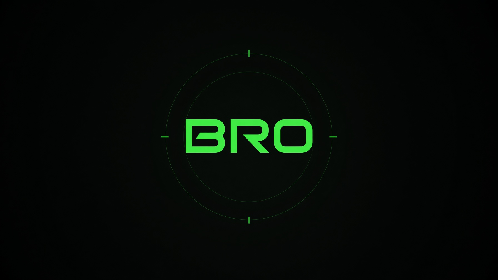

<p align="center">
  
</p>

<p align="center">
  <a href="https://codesbyfebin.github.io/bro/">Open the live desk</a>
  ·
  <a href="https://github.com/CodesbyFebin/BRO-Personal-Ai">Source</a>
</p>

# BRO

BRO is a personal AI command desk. The public page on GitHub Pages reads live data in the browser, answers through a free router, and offers opt-in browser push-to-talk and speech replies. It does not send trades, it does not hold API keys, and it does not pretend a local rule is a cloud model.

The root `index.html` remains the static GitHub Pages desk. The runnable, server-backed Command Centre is in [`command-centre/`](command-centre/README.md); it includes Task Console, Mission Board, Event Stream, Cloud Models, Agent Crew, Memory Core, and Safety Gate sections. Cloud model keys stay in the server environment. GitHub Pages does not run that backend.

Built by [CodesbyFebin](https://github.com/CodesbyFebin).

## Live desk

The published page is [codesbyfebin.github.io/bro](https://codesbyfebin.github.io/bro/).

On load it does three things:

1. It reads the clock in the browser.
2. It asks the public GitHub API for the latest repositories under CodesbyFebin.
3. It asks Dexscreener for ORE and SOL, and Coinbase for the USDC spot.
It does not ask for microphone access or send a prompt until you choose an action. Press **Talk to BRO** to begin a single push-to-talk interaction. Browser speech recognition may use the speech service configured by the browser. There is no wake word or background listening. A voice question goes to the same free router as typed questions, and the returned answer is spoken by the browser when voice replies are enabled.

Sync repeats the GitHub and mark fetch. Ask posts one short prompt to the anonymous free router. Prompts leave the browser, so do not enter secrets or private messages. If that router answers `402`, the page reports the rate limit. It does not invent a reply.

The crew lines on the page are computed from those marks. Watch names the ORE print. Thesis says whether ORE is the red sleeve. Neither line is an order.

## What this repository contains

| Path | Role |
| --- | --- |
| `index.html` | The desk, one file, no build step |
| `assets/hero.jpg` | The banner at the top of this README |
| `.nojekyll` | Stops GitHub Pages from running Jekyll on the file |

There is no package manager, no bundler, and no secret in the tree. You can open `index.html` from disk. The fetches still need a network.

The same file is also copied to `docs/bro/index.html` on [codesbyfebin.github.io](https://github.com/CodesbyFebin/codesbyfebin.github.io), because that site publishes from its `docs` folder. This repository is the source you edit. The user site is the host that is already switched on.

## What is live

These calls leave the browser. They use public endpoints. They do not use a token from this repo.

**GitHub.** `GET https://api.github.com/users/CodesbyFebin/repos?sort=updated&per_page=6`. The page lists the name, the public star count, and the repository URL. It does not list private repositories, and it does not read issues, pull requests, or commit bodies. A star count of zero is a real zero, not a placeholder.

**ORE.** Dexscreener token `oreoU2P8bN6jkk3jbaiVxYnG1dCXcYxwhwyK9jSybcp` on Solana. The page keeps the pair with the highest reported liquidity whose base symbol is ORE, then shows the USD price and the 24 hour change.

**SOL.** Dexscreener token `So11111111111111111111111111111111111111112`, the wrapped SOL mint, same liquidity rule, same 24 hour field.

**USDC.** Coinbase spot `USDC-USD`. The interface labels this as a spot quote and does not invent a 24 hour percent.

**Ask.** `POST https://text.pollinations.ai/openai` with model `openai`. That name is the anonymous model on the classic free router. The page prints the text in `choices[0].message.content` and nothing else. It does not claim the answer came from Claude, Gemini, or Grok.

If a feed fails, the page says which feed failed. It does not fall back to a canned price.

**Voice.** The page uses browser `SpeechRecognition`/`webkitSpeechRecognition` for click-to-talk input when supported and `speechSynthesis` for optional spoken replies. Browser support varies. Mic access is user-triggered and interruptible. Speech input may be handled by the browser's configured speech service; the page does not promise on-device transcription.

## What is not live

A static page cannot do the jobs that need a secret or a signature.

- It cannot call xAI. Grok 4.5 and Grok 4.6 stay on a server that holds `XAI_API_KEY`.
- It cannot call FreeLLMAPI. That router is local, at a `/v1` you run, and it wants `FREELLMAPI_URL` plus `FREELLMAPI_KEY`.
- It cannot place an order on an exchange. There is no wallet, no transaction, and no "confirm trade" button.
- It cannot see private GitHub data, Slack, a calendar account, or a bank.
- It does not use a paid voice service, wake-word listener, or streaming speech model. Browser speech output is a convenience feature; it is not a sub-two-second voice pipeline or a server agent.
- The crew sentence is a reading of the mark you just fetched. It is not a forecast and not a fill.

If a sentence on the desk says "no order was sent", that sentence is the product rule, not a caption on a hidden trade.

## How the page is built

The file is one HTML document. CSS and JavaScript sit in the same file so GitHub Pages has nothing to compile. The dark HUD uses a blue-black grid, acid green and cyan accents, and an animated voice core. Body type is IBM Plex Mono, with Chakra Petch on the wordmark, both loaded from Google Fonts. If the font host is blocked, the page falls back to a monospace stack and still works.

Layout is a header and system status, a command-centre hero, four live counters, then a GitHub feed beside the central voice/Ask console. The crew readout is below. On a narrow screen the counters stack in two columns and the panels flow vertically.

Primary controls are at least 44 pixels tall. Quick prompts are compact. Links open in a new tab with `rel="noreferrer"`. The prompt field stops at 500 characters, matching the cap used by the server desk.

There is no framework, no analytics snippet, and no cookie banner because the page sets no cookie. The only storage is whatever the browser does for a normal fetch. The desk does not write `localStorage` on this static build.

## Request shapes

GitHub, Dexscreener, and Coinbase are simple GETs. The browser sends them because those hosts answer with `Access-Control-Allow-Origin: *`. If a host drops that header, the page will show a failure instead of a number. Do not proxy them through a hidden server and then describe the result as a direct read.

The Ask body is:

```json
{
  "model": "openai",
  "messages": [{ "role": "user", "content": "<your line>" }]
}
```

The page does not send a system prompt, a temperature, or a tool list. The free router may still wrap the answer. What you see is the message content, trimmed only by the router itself.

Status handling:

| Status | What the page prints |
| --- | --- |
| 200 with text | The reply |
| 402 | Free router rate limit; wait and retry later |
| Other non-200 | Free router refused the ask, plus the status |
| Network error | Free router did not answer |
| 200 with an empty choice | Empty reply |

There is no automatic retry loop. The request is cancelled after 45 seconds. A second press before the rate limit resets may hit the same limit again.

## Marks, in detail

A mark has two parts: a dollar price and a signed percent.

The percent comes from Dexscreener `priceChange.h24` for ORE and SOL. The page formats a negative number with a minus sign and one decimal, for example `−3.1%`. A positive number gets a plus. If the 24 hour change is absent, the page shows `N/A`. USDC shows `SPOT`, because its Coinbase endpoint has no 24 hour field.

The dollar print uses two decimals at or above one dollar, and four decimals below that. ORE and SOL are both well above one dollar at the time this desk was wired, so you should see cents, not a long tail. If a future print is a fraction of a dollar, the page will show four places rather than round it to zero.

Pair choice matters. Dexscreener returns many pools. The page filters to Solana, then to the base symbol, then sorts by reported liquidity in USD and keeps the first. That is a display rule, not a best-execution rule. A thin pool can still win if the API lists it with the highest liquidity figure. The page does not check that figure against a second source.

USDC is read from Coinbase, not from a Solana pool, so its price is not mixed with the ORE pool's quote token. If Coinbase fails and Dexscreener succeeds, the ORE and SOL tiles update and the USDC tile stays on the loading mark.

The crew copy uses only the ORE change. If that change is below zero, Thesis calls ORE the red sleeve. If it is not, Thesis says there is no red sleeve on ORE. SOL can be red on the tile and still not move the Thesis line. That is deliberate and small. The static crew is a reading aid, not the five-seat pass described later.

## The five-seat crew, and why the page is smaller

The command-centre design has five seats: Watch, Thesis, Size, Risk, and Clerk. You are the gate between Risk and Clerk.

Watch reads the marks. Thesis states one claim and labels it inferred. Size proposes a weight move that still sums to 100. Risk holds the pen and refuses a live order. Clerk writes a receipt only after you sign. A refusal writes a receipt too, and the weights do not move.

The public page shows Watch and Thesis only, plus a Size line that says the book stays at 100. It does not keep weights, it does not offer Sign, and it does not write a receipt. Those steps need a store. On the server desk the store is `localStorage` under the name `bro-command-v1`. Signing there still does not broadcast a transaction. It changes the weights in the browser and appends a line to the local ledger.

If you expected the public page to rebalance a wallet, it will not. The red sleeve is a color on a percent. The next action is yours, outside this page.

## Model seats on a server desk

When BRO runs as a server, the roster is larger than the public page. The public page has one anonymous model. The server roster is a list of seats, and each seat has a wire. The wire is either xAI or the free router. The reply names the model that actually answered.

| Seat | Wire when a server is up | If FreeLLMAPI is configured | If it is not |
| --- | --- | --- | --- |
| Qwen 7B | edge | `auto:fast` | anonymous `openai` |
| Llama 8B | edge | `auto:fast` | anonymous `openai` |
| kimi-k3 | edge | `auto:fast` | anonymous `openai` |
| Grok 4.5 | xAI `grok-4.5` | still xAI | still xAI |
| Grok 4.6 | xAI `grok-4.6` | still xAI | still xAI |
| Claude | main | `auto` | anonymous `openai` |
| Codex | main | `auto:smart` | anonymous `openai` |
| Gemini | main | `auto` | anonymous `openai` |
| Gemini 3.5 | main | `auto:smart` | anonymous `openai` |
| DeepSeek | main | `auto` | anonymous `openai` |

Read that table as routing policy, not as a claim that Claude is on the key. The xAI key in the server environment has served `grok-4.5` and `grok-4.6`. It does not serve Claude, Gemini, or Codex. Those names are seats. When FreeLLMAPI is offline, Ask says `openai` in the reply so you can see the substitution. When FreeLLMAPI is online, the reply can include the `X-Routed-Via` header, which is the chain the router actually used.

Grok stays on xAI even if FreeLLMAPI is up. The queen path is separate from the free chains. The public page has no queen path at all.

Virtual models on FreeLLMAPI, when you point the server at your own router:

- `auto` is the best open chain.
- `auto:fast` is the cheap, quick chain. Edge seats use it.
- `auto:smart` is the harder chain. Codex and Gemini 3.5 use it.

Those three buttons are closed in the interface until both environment variables are set. The check is a boolean. The URL and the key are not sent to the browser.

## One door

The server desk has a probe box called One Door. You type a job. A local function, `routeWork`, picks a seat and a spare.

The rule is short. If the text matches review, code, deploy, trade, research, and the other heavy words, or if it is long, the tier is main. If it matches format, classify, remind, status, and the other light words, the tier is edge. The seat is chosen from the seats in that tier that you have not tripped. A hash of the text spreads jobs across the open seats so the same sentence does not always land on the same name. Trip a seat and the next job skips it. Restore it and it returns to the pool.

One Door does not call a model until you press Ask. The pick is visible first: seat, spare, and tier. That is the point of the door. You see the route, then you decide to spend a call.

The public page does not run `routeWork`. It has one Ask button and one model name. If you want the door, you want the server desk, not the Pages file.

## Voice, stills, and clips

On the server desk the command line accepts a few intents.

- A normal line is either a local command or a question for the queen.
- "Say" opens the studio and speaks. The browser voice is the default. A Grok voice toggle uses the server text-to-speech path and falls back to the browser if that path fails.
- "Draw" and "clip" call the server media functions. They need the same xAI key. They do not run on the public page.
- Assign, remember, approve, and deny change the local store. They do not post to GitHub or to a social network. A draft can be marked posted. That mark is a checkbox in the store, not a publish.

The microphone uses the browser speech recognizer when the browser has one. If it does not, the button stays disabled. Recognition is one shot, English, with interim results off. The heard line is submitted like a typed line.

None of that is in `index.html`. Listing it here is so the public page is not confused with the full desk.

## GitHub Pages, exactly

GitHub Pages serves files. It does not run a Node server. That is why this repository is one HTML file.

The user site `codesbyfebin.github.io` publishes from the `docs` directory on `main`. A file at `docs/bro/index.html` becomes `https://codesbyfebin.github.io/bro/`. The root of that repository is not the published root. Putting the desk at `/bro/index.html` on that repo does nothing until it is also under `docs`.

This repository, `BRO-Personal-Ai`, holds the source copy at `/index.html`. Turning on Pages for this repository itself needs the Pages API, and the token used to push the first commit could not change that setting. The live URL above is the one that already builds. If you later enable Pages on this repository from the GitHub UI, the same `index.html` will serve at `https://codesbyfebin.github.io/BRO-Personal-Ai/` without a build.

`.nojekyll` is in the root so a future Pages setting that uses this repository will not hide the file or rewrite it. The user site already has its own `.nojekyll` under `docs`.

There is no GitHub Action in this repository. The page does not need one. A push of `index.html` is the release.

## Run it yourself

From a clone:

```bash
git clone https://github.com/CodesbyFebin/BRO-Personal-Ai.git
cd BRO-Personal-Ai
python3 -m http.server 8080
```

Open `http://127.0.0.1:8080/`. Some browsers block `file://` fetches. Use a local server if the tiles stay on "loading".

To refresh the public copy, edit `index.html` here, copy it to `docs/bro/index.html` on `codesbyfebin.github.io`, and push that repository. Pages rebuilds on its own. A rebuild often finishes in under a minute. Until the build status is `built`, the old file can still be what you see.

## Design

The desk is a reading surface, not a marketing site. Numbers are tabular. Labels are short and tracked out. The only motion on the public page is a slow glow on the Watch line, so you can see that the crew row is the live one. The glow is a box shadow. It does not move layout.

Color is limited on purpose.

| Token | Hex | Use |
| --- | --- | --- |
| Background | `#030806` | Page |
| Surface | `#0b1410` | Cards |
| Line | `#1c3328` | Borders |
| Text | `#e7f6ee` | Body |
| Muted | `#7d9b89` | Hints |
| Primary | `#3dff8a` | Marks, links, the wordmark |
| Danger | `#ff6b6b` | A negative 24 hour change |

The hero at the top of this README is the same palette: a green wordmark, a thin ring, and empty dark around it. It is not a screenshot of an account, and it is not a third-party logo.

## Privacy

The public page sends your Ask text to the free router. Treat that box like a message to a third party. Do not paste keys, wallet seeds, or private mail.

The GitHub call is a read of a public user. It sends no authentication header. Anyone can make the same request.

Dexscreener and Coinbase see your IP the way any public API does. The page adds no tracking parameter.

The server desk, where it exists, keeps tasks, approvals, memory, and the book in `localStorage` on that browser. Clearing site data clears the desk. The xAI key never goes to the browser. Media calls are server functions. If you fork this HTML file and paste a key into it, you have broken that rule. Do not.

## Limits you will hit

The free router is shared and anonymous. One reply about every 30 seconds is the limit the page was written against. A busy address can be slower or emptier. The page will not queue prompts.

GitHub's public API is rate limited by IP. A normal Sync is one call. A script that hammers Sync from one address will get `403` or `429`, and the card will say GitHub did not answer.

Dexscreener can return an empty pair list. The tile then stays on the loading mark and the feed line says the marks did not load. That is better than showing yesterday's number with no label.

Coinbase can change the spot field. The page reads `data.amount`. If that field disappears, USDC stays unloaded and the other two marks can still render.

The page does not paginate GitHub. You see up to six repositories, the most recently pushed. A repository that has not been pushed recently will not appear even if it is important. Open the GitHub profile for the full list.

## Operator notes

Use the public page to see whether the feeds are alive and to ask a short question that can survive a public log. Use a server desk when you need Grok, a signature, or a model roster.

When you read a mark, read the percent and the dollar together. A green percent on a thin pool is still just a percent. The page does not tell you the pool's liquidity on the tile. If you need that, open the Dexscreener pair yourself. The mint addresses are in this README so you can.

When Thesis says ORE is red, it means the 24 hour field was negative. It does not mean the book should move. On the server desk, Size may propose a five-point shift toward USDC, and you still have to sign. On this page, no shift is offered.

When Ask returns a fluent paragraph, the fluency is the router's, not a receipt from this desk. The desk did not check the facts. If you need a number from the tiles, read the tiles. Do not ask the model to repeat them and then trust the repeat.

## Failure stories

These are the failures the page is built to show, rather than hide.

The GitHub request throws. The feed line says GitHub did not answer. The repository list stays empty. The counters for marks can still fill, because that work is a separate try.

The mark requests throw. The feed line says the marks did not load. GitHub can still list repositories. Watch stays on "Waiting on marks." Thesis stays on the idle claim. The page does not invent `+2.4%`.

Ask is pressed with an empty box. Nothing is sent.

Ask is pressed twice in a few seconds. The second call is the one that usually sees `402`. The first reply, if it arrived, stays on screen until the second response replaces it. There is no history stack on the public page. Copy the line if you need to keep it.

The font host is down. The page uses the fallback monospace. Layout does not depend on the webfont metrics beyond the wordmark size.

JavaScript is off. You see the header and empty cards. The desk cannot fetch without a script. There is no server-rendered number to fall back to, because Pages is not running a server.

## What a fork should keep

If you fork the page, keep the sentences that say where a number came from. Replace the GitHub user if you want your own repositories. Replace the mints if you want other assets. Do not leave the CodesbyFebin name on a page that reads someone else's account, and do not leave the ORE mint in place if you have swapped the symbol.

Keep the status text for `402`. People will press Ask twice. A silent failure looks like a broken button.

Keep the "no order" line. The moment the page shows a price, some readers will think a button sells it. The page has no such button. The sentence is there so the UI does not imply one.

Do not add a key to the HTML to "upgrade" Ask to a named cloud model. If you want named models, run a router on a server and call it from a server. The FreeLLMAPI notes above are the shape of that upgrade. The key stays in the environment.

## Relation to other desks

BRO has been sketched against three outside patterns, without copying their brands and without calling them from this page.

A one-door router is the idea that one job enters and a policy picks a seat, with a spare if the seat is down. One Door on the server desk is that idea, implemented as a local function. This page is the smaller version: one job, one anonymous model, no spare.

An agent card is a seat with a skill and a text modality. The server colony shows those cards. A job moves through queued, running, and review. Nothing on the card calls an outside agent by itself.

A server voice bench can add local streaming speech and a separate paid voice path. This public page has only browser-provided push-to-talk and speech synthesis, with an explicit mic click and no wake word. It has no paid voice key, no server voice pipeline, and no latency claim.

FreeLLMAPI is a local OpenAI-shaped router with virtual models `auto`, `auto:fast`, and `auto:smart`, and a response header that names the chain. The server desk can call it. This repository does not embed it. You run it yourself if you want those chains.

## FAQ

**Is the price on the tile a quote I can hit?** No. It is a public print from Dexscreener or Coinbase at the moment of the fetch. It can be stale by the time you read it. Sync again if you need a newer print. Neither source is your broker.

**Does Ask use Grok?** Not on this page. The reply is from the anonymous `openai` model on the free router. Grok is used only on a server that has an xAI key, and only after you send a line.

**Why do the tiles sometimes disagree with an exchange app?** The pool, the venue, and the clock differ. This page picks one liquid Solana pair and one Coinbase spot. Your app may use another venue. The page does not blend them.

**Can I trade from the crew lines?** No. Watch and Thesis are sentences. There is no size button on the public page.

**Where are the other nine models?** They are seats on the server desk. They are not separate calls on this page. See the table above before you tell someone Claude answered.

**Why is the live site not on this repository's Pages URL?** The token that created the commit could not enable Pages here. The user site was already publishing from `docs`, so the file was placed at `docs/bro/index.html` there. The source you are reading is still this repository.

**Does the page track me?** It does not set a cookie and it does not load an analytics script. The APIs you call see a normal browser request.

**Can I run this offline?** You can open the file. The tiles and Ask need the network. There is no cached price in the file, on purpose.

**What license is this?** This repository does not ship a license file yet. Do not assume a grant that is not written down.

## A short tour, in order

Open the live URL. The header is the word BRO, public-feed status, and a clock. The clock uses your machine's locale and updates every second. It is not a market clock and not a session clock from an exchange.

The four counters start as ellipses. They fill when the fetches return. GitHub's counter is the number of repositories in the list, at most six. ORE and SOL show 24 hour percent changes; USDC shows `SPOT`. Under each market figure is the dollar print, in smaller type.

The GitHub card lists names as links. The star count sits on the right. Sync is under the list. The line under Sync is the feed status. A good fetch says the repos and marks are live and that no order was sent. A bad fetch names the side that failed.

The central voice card has an animated core, opt-in mic control, a visible transcript, a text field, and a response area. Press Talk to BRO for one voice turn; press it again to stop listening or interrupt speech output. Turn on Speak text replies if you want typed questions spoken too. The question field is blank until you enter a prompt or pick a quick example.

The crew card is last. Watch updates when ORE has a price. Thesis updates from the sign of the ORE percent, and labels it as a mark rather than a forecast. Size does not update, because the public page does not keep weights. The note under the card repeats the rule: live marks, and a pass does not send an order. There is no pass button.

Sync reloads the public GitHub and market feeds. The system status distinguishes loaded feeds from unavailable ones. No wallet or order controls are present.

## Numbers the desk refuses to invent

Older sketches of this desk carried sample marks, sample pull-request counts, and a mirror tick that incremented when you pressed Sync. Those numbers were labels. They were not fetches. The public page does not do that.

Sync does not add one to a commit counter. It asks GitHub again. If GitHub returns the same six names, the card looks the same. That is a successful refresh, not a stuck button.

The book does not start at a fake `+2.4%`. It starts blank and waits. A blank tile is an unloaded tile. A filled tile is a fetch. There is no third state.

The queen, on a server, is told not to invent pull requests, balances, or prices. The public page enforces the same idea by not asking the model to be the source of the tiles. The tiles are the source. The model is a separate box.

## If you are wiring a server later

Keep the public page dumb. Add the server beside it, not inside the HTML.

Set `FREELLMAPI_URL` to the origin plus `/v1`, for example `http://127.0.0.1:3001/v1`. Set `FREELLMAPI_KEY` to the router key. Do not commit either value. The server should reject any URL that is not `http` or `https`.

Set `XAI_API_KEY` only on the server. Call `grok-4.5` for the queen and `grok-4.6` for that seat. Cap the tokens. If the call fails, say it failed. Do not answer as Grok from the free router and keep the Grok label.

When a non-Grok seat falls through to `openai`, print both names. The seat is what you asked. `openai` is what spoke. Readers can forgive a fallback. They cannot forgive a label that hides it.

Store signatures locally. A signed line is a receipt in the ledger. It is not a transaction hash. If you later attach a real signer, that is a different product, and this README should be rewritten before that button ships.

## Credits

The desk is a CodesbyFebin project. The public reads use GitHub, Dexscreener, and Coinbase. The anonymous ask uses the classic Pollinations text endpoint. None of those providers are affiliated with this repository. Their names are here because the page calls them, not because they endorse it.

The hero image is a wordmark for this README. It is not a trademark filing and not a screenshot of the live page.

## Status

The public desk is a static file with live reads, one anonymous ask, and an opt-in browser voice interaction. The server roster, signing crew, paid voice services, and autonomous execution are not part of this file. If a line in this README and a button on the live page disagree, trust the page, then fix the README. The page is the build. This document is the map.
